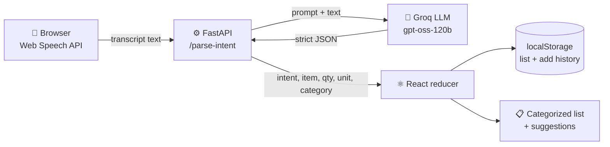

<div align="center">

# 🎙️ VoiceCart

### Talk to your shopping list. It listens, understands, and organizes.

Say *"I need two bottles of water"* and watch it land in the right aisle, with smart suggestions for the things you always forget.

[](https://voicecart-shopping-assistant.vercel.app)
[](https://voicecart-shopping-assistant.onrender.com/health)


<!-- Add a screenshot or demo GIF at docs/demo.gif, then keep the line below -->


</div>

> **Heads up:** use **Chrome or Edge** for voice input (Web Speech API).
> The backend is on Render's free tier and sleeps when idle, so the very first request can take 30 to 60 seconds. After that it's instant.

---

## 💡 The problem

Typing a shopping list on a phone while your hands are full is a small, constant annoyance. Existing voice assistants need rigid commands ("Add item: milk") and don't organize anything.

## ✅ The solution

VoiceCart understands **natural speech**, not commands. Phrase it however you like and it figures out the intent, quantity, unit and category on its own.

---

## ✨ Features

| | Feature | How it works |
|---|---|---|
| 🎤 | **Voice input** | Push-to-talk mic with a live transcript |
| 🧠 | **Natural language understanding** | "Add apples", "I need apples", "I want to buy 3 apples" all work, including number words like *"add four cauliflower"* |
| 📝 | **Add / remove / modify** | Fully by voice. Tap ✕ to remove manually |
| 🗂️ | **Auto-categorization** | Produce, Dairy, Bakery, Beverages and more, assigned by the LLM |
| 🔢 | **Quantities and units** | "2 bottles of water" becomes quantity 2, unit *bottles*. Repeat adds merge instead of duplicating |
| 💡 | **Smart suggestions** | Items you add often but don't have right now appear as one-tap chips |
| ⚡ | **Real-time feedback** | Live transcript, loading state, success/error toasts, graceful mic and API failure handling |
| 📱 | **Mobile-friendly** | Single-column layout, big tap targets, dark UI with animations |

### 🗣️ Try saying

| You say | What happens |
|---|---|
| *"Add milk"* | Milk goes to **Dairy** |
| *"Add 2 bottles of water"* | Water ×2 bottles in **Beverages** |
| *"Add four cauliflower"* | Cauliflower ×4 in **Produce** |
| *"Change milk to 5"* | Updates the quantity |
| *"Remove apples from my list"* | Removes apples |
| *"Add bread"* twice, then remove it | A 💡 suggestion chip for bread appears |

---

## 🏗️ Architecture



**The LLM contract.** The backend forces the model to return exactly this shape:

```json
{
  "intent": "add",
  "item": "water",
  "quantity": 2,
  "unit": "bottles",
  "category": "Beverages"
}
```

`intent` is one of `add`, `remove`, `modify`, `search`, `unknown`. Anything that isn't a shopping command comes back as `unknown` and the user gets a friendly message instead of a broken list.

---

## 🧩 Engineering decisions

**One LLM call instead of a hand-built NLP pipeline.** Intent detection, entity extraction, number-word conversion and categorization would normally be four separate components. A single structured-output call handles all of them, in any phrasing, and is far easier to maintain.

**API key stays on the server.** The browser only talks to my FastAPI backend, which holds the Groq key. Nothing secret ships in the frontend bundle.

**Reducer-driven state.** Every voice command becomes an action on a single reducer, so behavior (merge duplicates, "not on your list" errors, feedback messages) lives in one testable place instead of being scattered across components.

**Browser speech recognition.** The Web Speech API is free and needs zero setup, which keeps the whole project runnable on free tiers.

**Defensive by default.** Mic permission denied, no speech detected, unsupported browser, LLM failure and network errors each surface a clear message. The LLM response parser also tolerates code-fenced JSON.

**Deploy-ready config.** CORS origins and the API URL come from environment variables, so the same code runs locally and in production.

---

## 🛠️ Tech stack

| Layer | Choice |
|---|---|
| Frontend | React 19 + Vite, plain CSS |
| Voice | Web Speech API |
| Backend | FastAPI + Pydantic |
| LLM | Groq, `openai/gpt-oss-120b` |
| Hosting | Vercel (frontend), Render (backend) |

---

## 📁 Project structure

```
voicecart-shopping-assistant/
├── frontend/
│   └── src/
│       ├── components/     ShoppingList, ListItem, SuggestionChip
│       ├── hooks/          useSpeechRecognition, useShoppingList
│       ├── services/       api.js
│       ├── App.jsx
│       └── App.css
└── backend/
    ├── main.py             routes, CORS, validation
    ├── llm.py              system prompt + Groq call
    ├── requirements.txt
    └── .env.example
```

---

## 🚀 Run it locally

**1. Backend**

```bash
cd backend
python -m venv venv
venv\Scripts\activate          # macOS/Linux: source venv/bin/activate
pip install -r requirements.txt
```

Create `backend/.env` (see `.env.example`):

```
GROQ_API_KEY=your_groq_api_key_here
ALLOWED_ORIGINS=http://localhost:5173
```

```bash
uvicorn main:app --reload
```

**2. Frontend**

```bash
cd frontend
npm install
npm run dev
```

Open **http://localhost:5173** in Chrome. Get a free Groq key at [console.groq.com](https://console.groq.com).

### Environment variables

| Where | Variable | Purpose |
|---|---|---|
| backend | `GROQ_API_KEY` | Groq API key |
| backend | `ALLOWED_ORIGINS` | Comma-separated frontend origins allowed by CORS |
| frontend | `VITE_API_URL` | Backend base URL (defaults to `http://127.0.0.1:8000`) |

---

## 🔌 API reference

### `POST /parse-intent`

```json
// request
{ "text": "I need 2 bottles of water" }

// response 200
{ "intent": "add", "item": "water", "quantity": 2, "unit": "bottles", "category": "Beverages" }
```

| Status | Meaning |
|---|---|
| `400` | Empty text |
| `502` | LLM provider error |

### `GET /health`

Returns `{"status": "ok"}`. Interactive docs are at `/docs` (Swagger UI).

---

## 🧭 Scope and roadmap

Built within an 8-hour limit, so I prioritized a reliable, polished core over a wide, shallow feature set.

**Shipped**

- [x] Voice capture with live transcript
- [x] LLM-based intent parsing (phrasing variety, number words)
- [x] Add / remove / modify with quantities and units
- [x] Automatic categorization
- [x] History-based smart suggestions
- [x] Loading, error and feedback states
- [x] Deployed (Vercel + Render)

**Next up**

- [ ] **Multilingual voice:** the LLM already understands many languages; the missing piece is switching `recognition.lang` from a language picker
- [ ] **Substitutes:** suggest alternatives (almond milk for milk) from a curated product catalog
- [ ] **Seasonal and on-sale picks:** needs a pricing or promotions data source
- [ ] **Voice search with brand and price filters:** the `search` intent is already parsed; it needs a product catalog to search
- [ ] **Accounts and sync:** move storage from `localStorage` to Supabase
- [ ] **Time-based restock prediction:** learn each item's buying interval instead of counting adds

### Known limitations

- Suggestions are frequency-based (added 2+ times and currently missing). A production version would predict when each item runs out.
- The list lives in the browser's `localStorage`: per-device, no accounts.
- Voice input depends on Web Speech API support (Chrome and Edge).

---

## 👤 Author

**Saksham** · [GitHub](https://github.com/sakshamm1006)

Built as a technical assessment project. Feedback and ideas are welcome.
